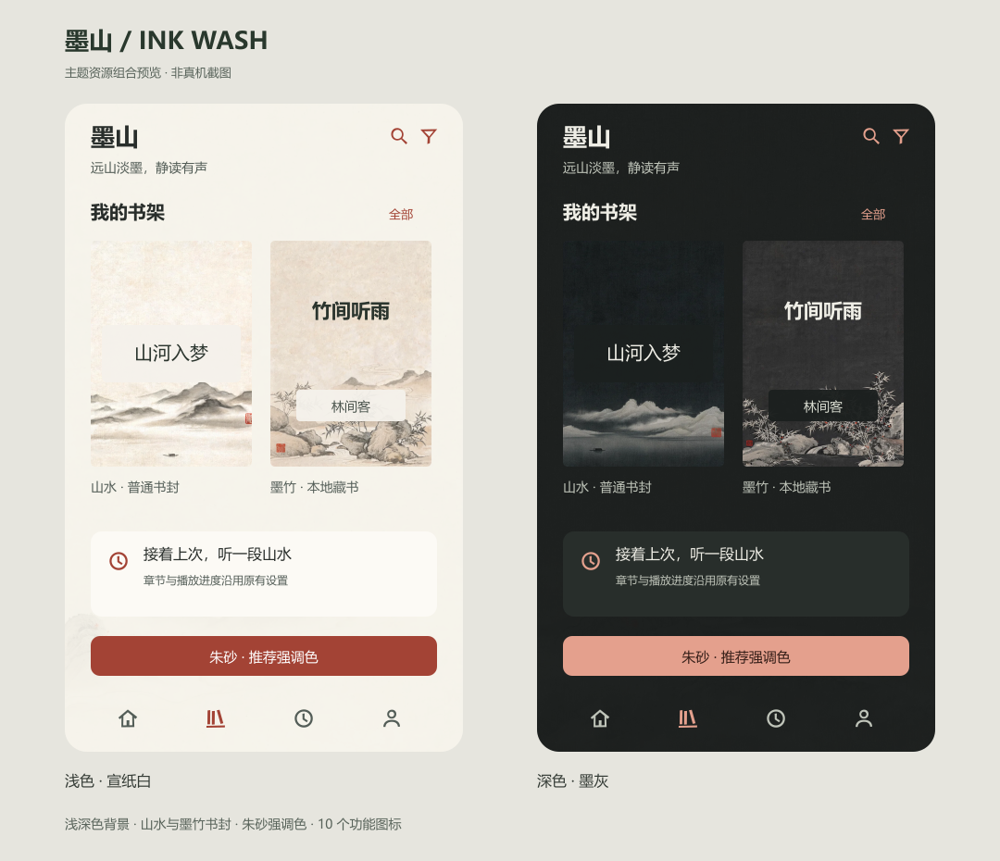

# 墨山主题

主题 ID：`ink-wash`。入口：我的 → 主题 → 主题套装 → 墨山。

## 设计

以宣纸留白和淡墨山水为主体，朱砂强调色用于选中、按钮和进度。交互文字沿用现有字号和系统字体，避免装饰字体降低识别性。深色模式单独绘制墨灰山水，不直接反转浅色素材。

| 角色 | 浅色 | 深色 |
| --- | --- | --- |
| 背景 | `#F5F2EB` | `#1C201F` |
| 卡片表面 | `#FCFAF5` | `#282E2B` |
| 主文字 | `#292E2B` | `#EEEDE5` |
| 次文字 | `#535D57` | `#C0C5BA` |
| 推荐强调色 | `#A34335` | `#E4A08D` |
| 强调色上文字 | `#FFFFFF` | `#341D17` |

- 背景：浅深两套图片均以 100% 不透明度显示原图，保留纸张纹理及下缘山水，不做整体淡化；关闭真实书封氛围背景。
- 普通无图封面：远山、江面与孤舟；运行时的书名沿用公共组件的文字底板。
- 本地无图封面：墨竹与溪石，标题位于上部留白区，作者在 66%–80% 高度叠加浅/深底色标签，避免与竹枝重叠后失去对比。作者为空时不绘制标签。
- 图标：10 个 24×24 单色填充 SVG，微不规则边缘表达运笔；保持搜索、筛选、网格、列表、箭头、首页、书架、记录、我的、分类的既有语义，统一由组件染色。
- 书封装饰：普通封面叠加细书脊和边框，紧凑封面只绘制细边框；真实书封仍显示原图，不将素材写入书籍数据。

## 接入

`theme/bundles/InkTheme.ets` 定义全部视觉资源；`ThemeBundles` 注册工厂。使用既有 Image 背景、Spine 装饰、局部预览与图标角色能力，背景组件覆盖首页、书架、记录、我的。`background.imageOpacity` 使用 1，完整显示原图；`cover.authorBackground` 为墨山本地封面的作者提供底色，没有新业务页面分支、用户状态字段或存储版本。

推荐材质为 3。用户自定义强调色与材质继续由原偏好服务管理，可恢复推荐值。阅读正文配色、桌面图标和真实书封仍由各自设置管理。

## 媒体生成与维护

6 张最终图片由即梦 `dreamina` CLI 的默认 5.0 模型生成，每次 1 张、2K。浅深背景为 9:16，普通/本地封面为 2:3。初稿 6 次文生图，随后对两张本地封面和深色背景各进行一次图生图修正，共 27 积分。画布 CLI 的模型接口返回 access_denied，因此本次无画布产物，使用独立生成任务交付。

共同提示方向：极简宋画意境、细腻宣纸、低饱和淡墨、大片留白、无文字、无产品样机。浅色使用暖白宣纸，深色使用炭灰纸张；背景山水集中在下缘，本地封面上部 85% 要求留空。深色背景修正要求将最亮山水压低至接近 `#343A36` 的暗灰，以实际生成结果和文字对比度检查为准。

最终应用文件仅做等比缩小与 WebP 编码：背景宽 900 px，封面宽 600 px，质量 86；没有裁切和重新着色。运行时从本地资源加载，不依赖即梦网络。原始图片及完整提示保留在本机忽略目录 `.tmp/ink-theme/`，不随应用发布。最终文件、任务 ID、尺寸和 SHA-256 见 [素材清单](ink-wash-assets.json)。

图标直接制作成 SVG 路径，不使用位图描摹。修改图标应保留单色填充和 24×24 viewBox。

## 验证边界

主题回归覆盖墨山注册、预览隔离、全部图标角色、深浅资源、偏好保存/重启/备份/恢复推荐值及失败回滚。文字和交互色在语义背景上的对比度按 4.5:1 检查；背景图片和本地书封另检查文字区域。静态预览用于核对资源组合，不是真机截图。

背景按原图显示，语义色的对比度测试不代表文字叠加在山水图片上的实际对比度。正文或标签的可读性按实际文字区域处理，不以整体淡化背景代替；本地封面继续保留书名和作者标签底色。

2026-10-23：两项主题回归脚本通过；Release SDK 26.0.0.105 的完整 `assembleHap` 通过，使用临时副本和公共构建模板生成未签名 HAP。包内检查包含全部 16 个墨山媒体资源，元数据为 Release、最低 API 20、目标 API 26。原工程签名配置未修改。尚未做设备运行验收。

需在设备上验收：深浅模式切换、四套主题互切、长书名和作者排版、真实书封保留、自定义强调色/恢复推荐值，以及窄屏、横屏和大屏裁切。构建与模拟逻辑回归不替代上述运行验收。
